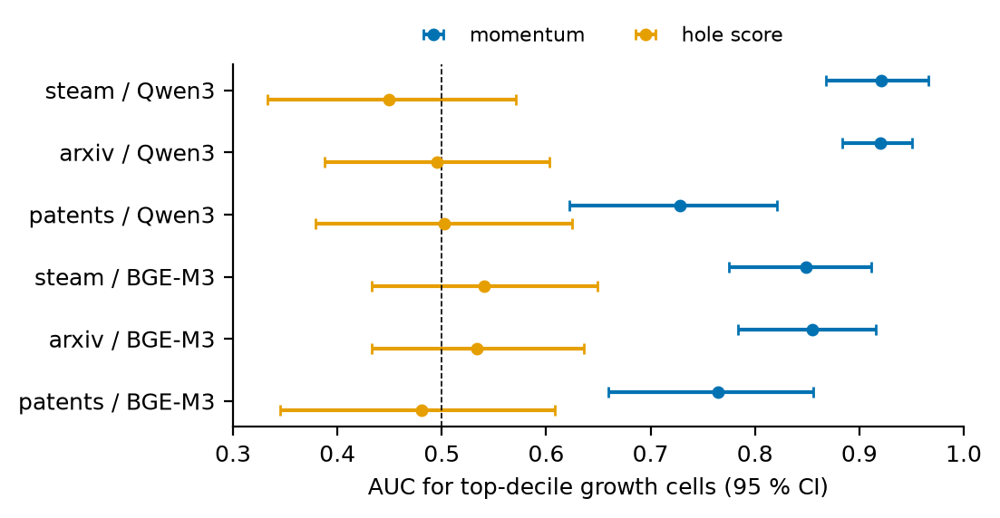

# Do Embedding-Map Distances Guide LLM Ideation? Four Tests Against What Came Next

**Javier Aguilar Martín**
AGILabs (javieraguilar.ai) · javiecija96@gmail.com

*Preprint, November 2026.*

---

## Abstract

A popular recipe for machine ideation treats an embedding map of existing work as a guide: sample its empty points,
decode them into ideas, prefer what is far from everything. I test four ways in which such distances are supposed to
guide ideation, each against what was published or released later. (1) **Empty points are not ideas:** holding the
target and its score fixed, swapping the neighbours shown to an LLM decoder moves the text towards the donor's
neighbours in 12 of 12 randomised cells, and later items, though often closer than the past, reach a cosine of at most
0.10 to a far point. (2) **Gaps do not forecast growth:** on Steam games, arXiv and patents, a hole score ranks the
fastest-growing regions of a past-only map at chance (AUC 0.45-0.54) while momentum reaches 0.73-0.92; holes go with
growth more clearly once momentum is held fixed, but add nothing to it as a forecast. (3) **Distance feedback does not
steer a continuation:** continuations of 150 arXiv papers by gpt-4o, OLMo and a 2026 model stay closer to their source
than the papers that later cite it, replicating Tang and Yang (2026) with generators trained before those papers;
feeding back the similarity to the citing papers, with or without its history, turns the ideas towards them by no
more than about 0.015 in cosine, and the small turns that critique produces also appear under content-free revision.
(4) **Inspiration distance has no sweet spot:** shown material from nine sources graded by distance, gpt-4o proposes
games whose anticipation of the post-cutoff Steam catalogue has no middle optimum, only a small positive slope in one
embedder and none in the other. Farther material makes the games more isolated and, under instruction, less coherent,
and showing an existing game anchors the new one to the past. What predicts the future is momentum; what moves the
model is content.

**Keywords:** idea generation, large language models, embedding spaces, novelty, forecasting, pre-registration

## 1 Introduction

Several lines of work treat distances in an embedding map of existing work as a guide to new work. EAGLE
(Tennenholtz et al., 2024b) steers a language model towards "content gaps" in a movie embedding; SciMON (Wang et al.,
2024) sends ideas back when they are too similar to the literature; benchmarks score ideas by their distance to what
exists, and Tang and Yang (2026) measure how far research agents step from their seed papers. A widely circulated post
on X put the premise in its plainest form (syntheticbeef, 2026): embed every Steam game, pick points of the space far
from all of them, convert each point back into a description, and rank the results by how unlike existing games they
are. I call this **gap-based ideation**. Its premise is that distances in an embedding map of existing work carry
information about where good new work lies, and that a model can be guided by them.

The premise splits into three testable claims about the map, plus a fourth about the material a model is inspired by.
This paper tests each against ground truth that a past-only map cannot see: the items released or published after a
frozen date.

1. **Empty points are ideas** (Section 3). If an LLM decodes a far point, the text should be about that point. I find
   that what the LLM writes is set by the neighbours it is shown, causally, and that no later item and no coherent text
   I could construct gets close to a far point; the past corpus's distance to them I could predict before building
   the targets.
2. **Gaps forecast where the future grows** (Section 4, pre-registered). I find that a hole score is at chance as a
   forecaster on three corpora, while momentum, the naive baseline, forecasts growth well; holes are associated with
   growth more clearly once momentum is held fixed, but add nothing to it as a forecast. Novel topic combinations
   behave the same way.
3. **Distances can steer a model continuing a paper** (Section 5, pre-registered with exploratory follow-ups). Real
   research starts from a given paper. I find that LLM continuations take a shorter step than the papers that came
   next, as Tang and Yang (2026) showed at scale, and that feeding back a similarity score towards the papers that
   later cited the source produces no detectable turn towards them, bounded at about 0.015 in cosine; critique
   lengthens the step beyond what revising alone does, but the small turns it produces come with revising.
4. **The distance of inspiration matters** (Section 6, pre-registered). Ideas often come from material that looks
   irrelevant. I find no middle distance at which material shown to the model best anticipates the games released
   after its cutoff; distance predicts how unusual the result is, and anticipation only through a small slope that
   one embedder shows and the other does not.

The four parts share one reading. Distances say where existing work is, and they are useful for that: momentum, a
statement about where recent items already are, is the strongest forecaster I found. They do not carry content, and
content is what moves a model.

## 2 Setup

**Corpora and maps.** Steam games (Fronkongames, 2024; released before 2024: 68,222 items after removing
adult-tagged rows; from 2024: 40,989), arXiv cs titles and abstracts (Cornell University, 2026; a seeded sample of
72,000 first versions before 2023 and 41,000 from 2023-01-01 to 2026-10-15) and US patent applications (HUPD, Suzgun et
al., 2023; filed 2012-2015: 71,521; 2016-2017: 40,342). Every map is built from past-split items only; the future
split is the ground truth. Two routes of leakage remain and I do not close them: the embedders were trained on text
that may postdate the splits, and an arXiv record's abstract is its latest version, which can be later than the
first-version date that assigns it to a split (Section 8). Appendix A.1 gives the details.

**Embedders and shared measures.** Qwen3-Embedding-0.6B (Zhang et al., 2025; d = 1024, L2-normalised) is the
pre-registered space, and BGE-M3 (Chen et al., 2024) is the replication space. Not every result was replicated, and
not every replication succeeded; each section says which (Table 6 in Section 8 summarises). All similarities are
cosines. An item's **isolation** is 1 − its maximum cosine to the past corpus. Its **latitude** is its cosine with the
normalised mean of the past corpus, its position on the cap that texts occupy (Section 3).

**Generators.** Table 1 lists every model and where it is used. The continuation and inspiration studies use
generators whose training predates their ground truth; the gaps study uses 2026 models, which postdate its splits,
and reads them only in ways that do not depend on the future (Section 8).

**Table 1.** Models. Cutoffs are the providers' published training cutoffs unless stated.

| Model | Role | Training cutoff | Sections |
|---|---|---|---|
| gpt-4o-2024-08-06 (OpenAI, 2024), temperature 1 | generator | October 2023 | 5, 6, A.7 |
| OLMo-7B-0424-Instruct (Groeneveld et al., 2024), temperature 1 | generator | February-March 2023 (Dolma; Soldaini et al., 2024) | 5 |
| gpt-5.4-mini (2026-03-17), temperature 1 | generator | 31 August 2025 (third-party listings; none published) | 5.4 |
| gpt-6-luna | decoder and generator | after all splits | 3, A.1-A.4 |
| Claude Sonnet 5.5 | decoder and generator | after all splits | 3, A.1-A.4 |
| gpt-6.1-sol, Claude Opus 5.5, Claude Haiku 5.5 | generators and judges | after all splits | 6, A.1, A.7 |

**Pre-registration and reporting.** Every confirmatory test was written down, with its predictions and analysis
rules, in a document committed to the project's git repository before the data it is tested on were generated or
inspected; the commit timestamps date them, and Appendix B lists them (the one exception, the neutral control of
Section 5.2, was written before its first call but committed with its results). Earlier work had used the same corpora
and splits: the decoding runs of Section 3 never touch the future split, and the memory probe of Appendix A.7 asks
only whether generated items land nearer later items. No analysis before its pre-registration looked at where future
items sit on the past map or how its cells grow, and the continuation and inspiration data were collected after
theirs. Deviations from a pre-registration are stated where they occur.
Analyses that were not pre-registered are marked as exploratory where they appear, and their p-values are
uncorrected. A failed prediction is reported as failed.

## 3 Empty points are not ideas

The recipe's decoder shows an LLM the eight nearest past items of a target point, asks for a new item, embeds it and
reports back the cosine reached and the best so far (score-only "hot-and-cold" feedback), over four rounds of three
candidates. If the map's empty points were ideas, the text should be driven by the target. Two results say it is
driven by what the model is shown.

**The shown content decides, causally.** I pre-registered a randomised intervention on 20 saved targets per arm in
Steam and arXiv, with two decoders (gpt-6-luna and Claude Sonnet 5.5): REAL (hidden held-out items, the positive
control), GAP (interior holes) and FAR (the recipe's far points). The target and the score feedback were held fixed;
only the shown neighbours changed, between the true ones, another target's (SWAP) and none. Swapping moved the decoded
text towards the donor's neighbours, relative to the true ones, in 12 of 12 cells (Figure 1; Table A2). For FAR
targets, the small landing on the target with the true neighbours (cosine 0.02 to 0.07) disappears with swapped or no
neighbours (−0.02 to −0.01): the score alone does not move text towards a far point. Even for a hidden real item, the
decoded text without neighbours stays at 0.36 to 0.47 from it, against 0.69 to 0.81 with them, and ends up only 0.03
to 0.07 closer to its own target than to another target of the same arm (0.036 to 0.071 for REAL). That margin is
what the decoder achieves from the score feedback alone; I ran no control without the score, so it bounds, rather than
measures, what the feedback contributes.
The direction of anchoring is causal; the one-coefficient law that the pre-registration froze for its size holds in
5 of 12 cells only (Appendix A.3).

**Far points are out of reach.** Texts occupy a narrow cap of the sphere (two Steam games have median cosine 0.41;
two random directions 0 ± 0.031), so a far direction is far from every text, not only from existing ones. From corpus
statistics alone I wrote down the median corpus ceiling of the arXiv FAR targets before building them: 0.062; it was
0.058 (Appendix A.3). That prediction concerns the past corpus. Whether later items come closer I checked only
afterwards (exploratory): across the 50 saved FAR targets of each corpus, the best cosine of any later item exceeds the
past ceiling on 58 % (Steam, patents) to 86 % (arXiv) of targets, but stays at 0.046 to 0.066 at the median and 0.1002
at most, against a past ceiling of 0.046 to 0.062. The future comes slightly closer than the past, and remains far. Searching for coherent text directly, without neighbours, does slightly better. A seed-and-rewrite
search with a passing positive control reached coherent text at least 0.05 above the corpus ceiling on 5 of 20 Steam
FAR targets, which refutes the pre-registered strong form of the objection on Steam (25 % against a 20 % threshold;
15 % if a third, independent model must also accept the text), but at cosine 0.09 to 0.14 to a target at distance 1;
on arXiv none escaped (Appendix A.4). So the claim is that no text I found or constructed reaches a far point, not
that none can: a bound of this kind cannot be certified from finitely many coherence labels (Appendix A.5).

Asking a generator for new items while showing it the titles it had already proposed, with no map at all, was judged
more novel by LLM judges than every map-guided arm in all three corpora, though my own blind ratings agree with the
judges only weakly (Appendix A.7).

## 4 Gaps do not forecast where the future grows

**Design (pre-registered).** I cluster each past map into 256 cells (k-means, refitted in each embedder, a deviation
from the pre-registration) and score each cell by **growth** (the future share over the past share), **hole** (the
share of 200,000 draws from the corpus Gaussian that fall in the cell over its share of past items) and **momentum**
(the share of the cell's past items from the last two past years). The forecasting target is whether a cell is in the
top decile of growth. Each future item is also checked for whether it lands in the **far region** (isolation ≥ 0.85,
that is, maximum cosine to the past ≤ 0.15, where the recipe's far targets sit). Table A1 has every prediction (F1-F6)
in every cell.

**The hole score forecasts at chance; momentum does not.** Ranking cells by the hole score gives AUC 0.45 to 0.54 for
top-decile growth, every 95 % interval including 0.5, against 0.73 to 0.92 for momentum (Figure 2; these AUCs are
computed on the score directly, an exploratory choice, because a cross-validated single-feature model with 26
positives can fall below 0.5 by the fold procedure alone). The pre-registered test (F3) holds in five of six cells:
momentum's cross-validated AUC is 0.71 to 0.92, and adding hole and latitude to it changes the AUC by −0.021 to
+0.006, except patents/BGE-M3 (+0.031). With a cluster bootstrap that keeps the copies of a resampled cell in one
fold and standardises inside training folds, the 95 % intervals of the gain end at +0.008 to +0.033 in Steam and arXiv
and at +0.051 (Qwen3) and +0.114 (BGE-M3) in patents (Appendix A.2): gains above about 0.03 are ruled out in Steam and
arXiv, not in patents. Momentum is a naive baseline; the point is that no gain from the map's gaps is detectable on top
of it.

**Holes go with growth more strongly once momentum is held fixed (F2 fails).** I predicted no association between growth and
hole after controlling for momentum and log past count. In Steam and arXiv the partial Spearman ρ is 0.17 to 0.20
(Qwen3) and 0.33 to 0.34 (BGE-M3), CIs excluding zero; in patents it is 0.07. The effect survives replacing the ratios
by their numerators (exploratory). This agrees with Luo and Evans (2026), who find in concept space that the future
fills small, nearby holes. It is still not a usable forecast. Without the control the association is weaker and less
consistent: the raw ρ is −0.07 to +0.08 and not significant in Steam and arXiv except Steam/BGE-M3 (+0.26), partly
because hole and momentum are negatively correlated in arXiv (ρ ≈ −0.2), while in patents the raw ρ is nominally
positive (+0.12 to +0.13, uncorrected p ≈ 0.04) and the partial one is not. And the partial correlation runs over the
whole range of growth, whereas the forecasting question is which cells grow most: there the hole adds nothing to
momentum (F3).

**Nothing lands in the far region (F1 holds).** None of 122,331 future items has maximum cosine ≤ 0.15 to the past; the
most isolated has 0.41 to 0.57. Items of one corpus measured against another corpus's past never land there either
(lowest maximum cosine 0.17 to 0.49, exploratory), so the far region is empty for any text, not only for future text.
The informative quantity is the size of the shift: the future is only 0.002 to 0.029 more isolated (median) than a
held-out slice of the past, while text from another domain sits 0.08 to 0.32 further out. What came next stayed almost
where the past already was.

**Novel combinations add nothing to momentum** (pre-registered). The Alien Space of Science (Artiles et al., 2026)
recovers future idea-atom triples far above uniform chance but leaves open how a momentum or popularity baseline would
do. On all 1,313,400 triples of 200 NMF topics of arXiv, momentum forecasts which triples appear in 2023-2026 papers
(29.1× chance in the top 0.875 %, AUC 0.969), and static popularity is nearly as good (28.2×). Within strictly novel
candidates momentum still ranks the ones that appear (30.9×, AUC 0.962), although on the full ranking unfitted
momentum puts none of them in its top 0.875 %. A fitted model free to use coherence and rarity gains +0.0002 AUC over fitted
momentum, and the embedding hole adds −0.0003. My coherence proxy, smoothed PMI, is inverted on its own (AUC 0.164),
because it rewards pairs of rare topics, so this says that cheap combination signals add nothing to momentum, not that
Alien Space's trained model would add nothing (Appendix A.6).

## 5 Distances do not steer a continuation

**Data.** 150 past arXiv cs papers dated 2021-2022 (the *contexts*), sampled with a fixed seed among those with at
least five *follow-ups*: arXiv papers that cite the context according to Semantic Scholar (Kinney et al., 2023) and
appeared on or after 2024-01-01, after every generator's cutoff; at most 50 per context, 2,883 in all. Throughout,
"follow-up" means a later citing paper, nothing more: in a labelled sample of 30, only 3 continue the context's own
work and the rest cite it as background or comparison (Section 8). What this section measures is whether the ideas
move where the literature that cites a paper later went, not whether they anticipate its true continuations. For
robustness I also use the **S2-flagged subset**: follow-ups that Semantic Scholar marks as influential (Valenzuela et
al., 2015) or with a methodology or result intent (Cohan et al., 2019), keeping contexts with at least three (68
contexts). On a labelled sample this subset does not overlap the content-based "continues" labels (0 of 3; Section 8),
so it is a robustness check on a different set, not a cleaner one.

**Measures.** For an idea or follow-up x of context c, **step** = cos(c, x), so a lower value is a longer step, and
"lengthening the step" means lowering it. **Fit** is the maximum cosine of an idea to the context's follow-ups. The
**step gap** is a context's median idea step minus its median follow-up step. The unit of analysis is the context,
with bootstrap CIs over contexts (2,000 resamples) and Holm correction within each pre-registered family.

### 5.1 The short step replicates

Asked once to "propose the paper that should come next" from a context's title and abstract, gpt-4o writes ideas that
stay closer to the context than the real follow-ups: the mean step gap is 0.149 (CI 0.138 to 0.160), and 0.140 with
the eight nearest past items shown (pre-registered B1, Holm p < 10⁻²⁴). The gap holds in BGE-M3 (0.168), in the
S2-flagged subset (0.129 and 0.159), and with OLMo (0.179 to 0.218), with p < 10⁻¹¹ in all eight
generator × embedder × follow-up-set cells. This is Tang and Yang's (2026) finding, not a new one; my design adds a
single-paper context and generators whose training predates every follow-up: querying the arXiv API, no follow-up's
first version is earlier than 2024-01-01 (2025-09-01 for Section 5.4), and where Semantic Scholar's date differs from
the first version it is the earlier one. Abstracts are latest versions, not first ones (42 % of follow-ups and 51 % of
contexts have more than one version; 8 of the 150 contexts were last revised after gpt-4o's cutoff), which changes the
text the model saw, not whether it could have seen a follow-up. Other one-shot variants (memory of earlier titles, a
verbal hint of where the area is moving) narrow the gap, but by at most a fifth (memory: 0.022 of 0.149, CI 0.016 to
0.028); they are in Appendix A.8.

### 5.2 Iterative critique (pre-registered)

**Design.** Same 150 contexts and generator. Per context and arm, three independent ideas, each refined over three
rounds (the one-shot prompt, then two revisions that see the context, the previous proposal and the round's
feedback). I call all three feedback arms **critique**:

- **GEO** (rule-based): the proposal's cosine to the context and the interquartile range of real follow-up steps (0.574
  to 0.661), with "take a bigger step", "keep a clearer link" or "keep the step". The band is an aggregate of the same
  150 contexts, a stated mild leakage.
- **Reviewer** (verbal): a separate gpt-4o call says whether the proposal is a genuine follow-up or a rephrasing, and
  what would make it a stronger next paper, in at most 80 words. It never sees a follow-up.
- **ORACLE** (leaks the future): the proposal's maximum cosine to the context's real follow-ups, "try to get closer".
  This is a **single-score oracle with no history or best-so-far**: each revision sees one number about its previous
  proposal. Section 5.4 tests a version with the history of scores and the best proposal so far.

Predictions: C1, GEO lengthens the step and closes at least 0.07 (in cosine) of the step gap; C2, GEO does not lower
the hit rate by more than 0.03; C3, the reviewer lengthens the step; C4, two-sided hit change under the reviewer; C5,
ORACLE raises fit, by less than 0.07. **Hit** is whether an idea's nearest neighbour among the follow-ups and the
same-category later papers is a follow-up (Appendix A.8).

**Table 2.** Iterative critique (gpt-4o, Qwen3), round 0 → round 2: means over 150 contexts of each context's mean over
its three ideas. Real follow-ups: median step 0.620.

| Arm | step | fit | hit |
|---|---|---|---|
| GEO | 0.766 → 0.679 | 0.677 → 0.636 | 0.627 → 0.518 |
| Reviewer | 0.766 → 0.703 | 0.679 → 0.647 | 0.644 → 0.591 |
| ORACLE | 0.761 → 0.729 | 0.677 → 0.666 | 0.664 → 0.611 |
| NEUTRAL (added later) | 0.766 → 0.722 | 0.677 → 0.662 | 0.627 → 0.613 |

- **C1 holds.** GEO lengthens the step by 0.087 (CI 0.080 to 0.094), closing 0.087 of the 0.148 gap of these round-0
  ideas (the separate one-shot run of Section 5.1 gives 0.149).
- **C2 fails.** GEO's hit rate drops by 0.11 (CI −0.16 to −0.06).
- **C3 holds.** The reviewer lengthens the step by 0.063 (CI 0.056 to 0.069).
- **C4.** Under the reviewer, hit drops by 0.05 (CI −0.09 to −0.02).
- **C5 fails.** I predicted that ORACLE would raise fit. It did not: fit fell by 0.012 (CI −0.016 to −0.007).

**A neutral revision control (pre-registered, added later).** None of the arms above separates the feedback from
revising as such. A NEUTRAL arm runs the same two revisions from the same round-0 ideas as GEO, each told only "Revise
your proposal: write an improved version." (900 gpt-4o calls). Revising with no information already lengthens the step
by 0.045 (BGE-M3 0.034) and lowers fit by 0.015. Against it, GEO and the reviewer lengthen the step further, by 0.042
(CI 0.034 to 0.050) and 0.018 (CI 0.010 to 0.026), Holm p < 10⁻³ in both embedders (N1, N2 hold), and lose more fit
(Qwen3; in BGE-M3 only the reviewer). So about half of GEO's lengthening and over two thirds of the reviewer's come
with revising, and ORACLE lengthens the step less than revising with no information does (−0.013, p = 0.003,
exploratory). The direction results of this control are in Section 5.3.

**Falling fit is not, by itself, a wrong direction.** Moving away from the context lowers the cosine to follow-ups that
share the context's direction, whatever the direction of the move. So the falls in Table 2 say that critique did not
bring the ideas closer to the follow-ups; they do not say where it turned them. That needs a test that does not depend
on step length.

### 5.3 Direction, measured independently of the step (exploratory)

The obvious baseline, comparing each idea with the later paper whose distance to the context is closest, is not
identified here: at round 0, 69 % to 97 % of the ideas are closer to their context than *any* later paper of the
corpus, and 40 % to 84 % still are at round 2, so the matched paper is systematically further out than the idea and
the comparison mixes direction with step (Appendix A.9). I therefore use a test that is step-invariant by
construction.

For an idea x of context c, its **tangent** is the unit vector of x − (x·c)c, the part of the move that is not
towards or away from c. Let f be the unit mean tangent of the context's follow-ups, p the unit mean tangent of its
nearest later papers outside the sampled follow-up set (as many as it has follow-ups), and s the unit vector of
f − (f·p)p, the **follow-up-specific** direction. That pool may contain citing papers, because 18 of the 150
contexts hit the cap of 50 saved follow-ups and citing papers from 2023 were not excluded; removing every citing arXiv
paper of any date (9,921, fetched without a cap) changes no contribution in Table 3 by more than 0.001 and leaves the
same two follow-up-specific changes significant after Holm. An idea's **alignment** is the cosine of its tangent with f. Because f = (f·p) p + √(1 − (f·p)²) s,
the change in alignment from round 0 to round 2 splits exactly into a contribution along p and one along s, each
weighted by its context's coefficient (mean weights 0.71 and 0.67 in Qwen3, 0.76 and 0.63 in BGE-M3). As a positive
control, the real follow-ups' own leave-one-out alignment (each follow-up against the mean of the others) is 0.468 in
Qwen3 and 0.525 in BGE-M3, so the metric detects a shared orientation when there is one. Tests are paired Wilcoxon
over contexts, with Holm over the 36 tests of this analysis (4 cells × 3 arms × alignment, along p, along s). OLMo,
the second generator, runs only the arms its 2,048-token window allows and one idea per context and arm (Appendix A.8).

**Table 3.** Tangent alignment with the follow-ups' direction, round 0 → round 2 (exploratory; means over contexts).
Alignment with its Holm-adjusted p; then the weighted contributions along p and along s, which add up to the alignment
change; then the follow-up-specific change itself (unweighted), with raw and Holm-adjusted p. The NEUTRAL rows were
added later, are outside the 36 tests and have no weighted decomposition.

| Generator / embedder | Arm | alignment r0 → r2 (Holm p) | contribution along p | contribution along s | change along s (p; Holm p) |
|---|---|---|---|---|---|
| gpt-4o / Qwen3 | GEO | 0.232 → 0.265 (1 × 10⁻⁷) | +0.022 | +0.012 | +0.015 (0.01; 0.11) |
| | Reviewer | 0.233 → 0.264 (9 × 10⁻⁹) | +0.026 | +0.004 | +0.006 (0.09; 0.47) |
| | ORACLE | 0.238 → 0.252 (0.06) | +0.017 | −0.002 | −0.003 (0.54; 1) |
| | NEUTRAL (Section 5.2) | 0.232 → 0.262 | — | — | +0.019 (5 × 10⁻⁴; not in the 36) |
| gpt-4o / BGE-M3 | GEO | 0.393 → 0.435 (2 × 10⁻⁹) | +0.024 | +0.017 | +0.024 (3 × 10⁻⁴; 0.005) |
| | Reviewer | 0.394 → 0.420 (4 × 10⁻⁹) | +0.023 | +0.004 | +0.006 (0.16; 0.62) |
| | ORACLE | 0.397 → 0.412 (3 × 10⁻⁴) | +0.015 | +0.001 | +0.001 (0.91; 1) |
| | NEUTRAL (Section 5.2) | 0.393 → 0.423 | — | — | +0.014 (0.007; not in the 36) |
| OLMo / Qwen3 | GEO | 0.221 → 0.297 (9 × 10⁻⁹) | +0.059 | +0.018 | +0.024 (0.01; 0.11) |
| | Reviewer | 0.210 → 0.263 (1 × 10⁻⁶) | +0.033 | +0.020 | +0.032 (5 × 10⁻⁵; 8 × 10⁻⁴) |
| | ORACLE | 0.215 → 0.253 (0.001) | +0.022 | +0.017 | +0.025 (0.02; 0.11) |
| OLMo / BGE-M3 | GEO | 0.360 → 0.436 (3 × 10⁻¹²) | +0.057 | +0.019 | +0.028 (0.007; 0.07) |
| | Reviewer | 0.351 → 0.405 (3 × 10⁻⁹) | +0.044 | +0.010 | +0.018 (0.02; 0.11) |
| | ORACLE | 0.360 → 0.391 (0.002) | +0.023 | +0.008 | +0.012 (0.19; 0.62) |

**Reading.** Alignment with the follow-ups' direction rises after critique in all 12 generator × embedder × arm cells
(uncorrected p ≤ 0.0054; 11 of 12 after Holm, the exception being gpt-4o/Qwen3 ORACLE at 0.06). Three things limit
what that says. First, the ideas stay well below the follow-ups' own alignment (at most 0.297 against 0.468 in Qwen3,
0.436 against 0.525 in BGE-M3; Figure 4). Second, the weighted contribution towards nearby later papers in general
carries most of the rise in every cell, 56 % to 95 % (all of it for gpt-4o/Qwen3 ORACLE). Third, after Holm only two
follow-up-specific changes remain significant: GEO for gpt-4o in BGE-M3 and the reviewer for OLMo in Qwen3; the others
are positive in most cells but not distinguishable from zero. And for gpt-4o the NEUTRAL control of Section 5.2, which
revises with no information at all, turns the ideas as much as any critique arm, follow-up-specific part included
(+0.019 in Qwen3, +0.014 in BGE-M3), so the turn comes with revising, not with what the feedback says. With 150
contexts these tests detect a follow-up-specific change of 0.012 to 0.017 in cosine with 80 % power (OLMo, with one
idea per context: 0.020 to 0.026). For gpt-4o under the reviewer and ORACLE the 95 % intervals lie within ±0.015,
and an equivalence bound of ±0.015, about the size of GEO's change in Qwen3, is accepted in all four cells (a
post-hoc bound, not a pre-registered one); OLMo/BGE-M3 ORACLE (CI −0.002 to +0.026) is inconclusive. With OLMo the step gap is larger (0.179 to 0.218) and critique lengthens the step in every
cell, as with gpt-4o; fit falls in 23 of 24 generator × embedder × follow-up-set × arm cells and rises significantly in
none (Table A6). OLMo has no NEUTRAL arm, so its follow-up-specific changes are untested against plain revision.

### 5.4 A 2026 generator, and score feedback with history (pre-registered)

Two questions were left open: whether the pattern belongs to 2023-era models, and whether the single-score oracle
fails only because it has no memory. I pre-registered both before any call. For the first, gpt-5.4-mini (released
March 2026; training cutoff reported as 31 August 2025 by third-party listings, with no official date published)
continues 150 arXiv papers from January to June 2025, the first 150 in a seeded order with at least five follow-ups
citing them from September 2025 on (2,331 follow-ups, at most 50 per context). For the second, a new arm, ORACLE-H,
shows the model all its earlier proposals with their similarity to the real follow-ups and revises from the best one
so far; it runs with gpt-4o on the original contexts and with gpt-5.4-mini on the new ones.

**Table 4. Modern generator and ORACLE with history** (Qwen3; change from round 0 to round 2, mean over 150 contexts,
Wilcoxon p in parentheses).

| Generator / arm | Step lengthened | Fit change | Alignment change | Follow-up-specific |
|---|---|---|---|---|
| gpt-4o / ORACLE | 0.032 | −0.012 | +0.014 (0.0052) | −0.003 (0.52) |
| gpt-4o / ORACLE-H | 0.023 | −0.008 | +0.018 (5 × 10⁻⁶) | +0.005 (0.13) |
| gpt-5.4-mini / GEO | 0.061 | −0.021 | +0.025 (6 × 10⁻⁵) | −0.003 (0.37) |
| gpt-5.4-mini / Reviewer | 0.050 | −0.022 | +0.003 (0.40) | −0.004 (0.59) |
| gpt-5.4-mini / ORACLE | 0.008 | −0.008 | −0.022 (2 × 10⁻⁵) | −0.006 (0.19) |
| gpt-5.4-mini / ORACLE-H | 0.012 | −0.007 | −0.012 (0.03) | +0.001 (0.96) |

The short step replicates with the 2026 model and is larger: its one-shot ideas sit 0.211 closer to the context than
the real follow-ups (0.198 with memory of its earlier titles; p ≈ 10⁻²⁶), against 0.149 for gpt-4o (a difference of
0.062, CI 0.046 to 0.077, on different contexts). Critique lengthens the step (GEO +0.061). The single-score oracle
does not detectably change the follow-up-specific direction (−0.006, CI −0.016 to +0.004, p = 0.19) and lowers the
overall alignment. History adds little: ORACLE-H's fit gain over ORACLE is +0.004 for gpt-4o (CI −0.003 to +0.011,
one-sided p = 0.20, the pre-registered H1 fails) and +0.001 for gpt-5.4-mini (CI −0.004 to +0.005, p = 0.48), so any
gain from the history is below 0.011 and 0.005 in cosine, far from the 0.07 the pre-registration allowed for. One
difference from the 2023-era models: with gpt-5.4-mini even GEO moves the direction only towards nearby papers in
general (+0.025), not towards the follow-ups specifically (−0.003, CI −0.015 to +0.010).

These non-significant results are bounded, not absent. With 150 contexts the follow-up-specific tests detect a change
of 0.013 to 0.017 in cosine with 80 % power, and the 95 % intervals of every null cell in Table 4 lie within ±0.016.
An equivalence bound of ±0.015, about the smallest follow-up-specific change I report in Table 3, is accepted in all
six (post hoc). For gpt-4o that bound is about a seventh of the distance between the ideas' and the follow-ups' own
projection on that direction; for gpt-5.4-mini, whose ideas start closer, it is a third or more, so its nulls say less.
Across three generators from 2023 to 2026, then, a similarity score towards what was really published, with or
without the history of its scores, produced no follow-up-specific turn larger than about 0.015 in cosine. Critique
lengthens the step in all three generators; the small turns it produces for gpt-4o also appear under neutral
revision.

## 6 Inspiration distance has no sweet spot (pre-registered)

Sections 3 to 5 show the model material of the same kind as the target: games to make a game, papers to continue a
paper. Someone with ideas also has around them material they never think of as relevant: a recipe, the rules of a
sport, a news item, a random encyclopaedia page. Design cognition has long disagreed about how far such inspiration
should be (Section 7), and none of that work scores the ideas against what was released later. If distance in an
embedding map guided ideation anywhere, it would be here, where it can be graded continuously within each kind of
material.

**Design.** I built a pool of 49,531 items from nine sources, dated before 2024: past
Steam games, board games (BoardGameGeek), film plots, Wikipedia articles describing a sport or game and its rules,
arXiv papers, patents, news items (AG News; Zhang et al., 2015), recipes (Food.com; Majumder et al., 2019) and random
Wikipedia articles. A stimulus's distance is its isolation from the Steam past, 1 − its maximum cosine to any past
Steam game. Within each source I cut the items into distance quintiles and drew 40 per source × quintile (1,800
stimuli). gpt-4o proposed one Steam game per call under two framings of the same stimulus: INCIDENTAL ("something you
happened to read today") and INSTRUCTED (the same, plus "use it as inspiration"). Two baselines need no stimulus: 200
ideas with no material (NONE), and 200 real 2023 games drawn from the fastest-growing cells of the past map
(MOMENTUM, Section 4). The ground truth is a stricter future than Section 4's: the 32,322 Steam games released from
2024 with an appid above 2,680,000, a proxy for a store page created after the cutoff; the MOMENTUM games are past
items and are not in it. The proxy can be checked only from release dates, which bound page creation from above: no
game above the threshold in the future set was released before 2024 and, apart from two apparent date errors, no game
above it was released before 18 November 2023. I therefore call the set contamination-reduced, not
contamination-free. The pool sampled the whole pre-2024 Steam split rather than stopping at the cutoff: 10 of the 200
Steam stimuli and 63 of the 200 MOMENTUM games were released between October and December 2023. An idea's anticipation is its **margin**: its maximum
cosine to those games minus its maximum cosine to a random sample of past games of the same size (averaged over five
samples), so that a positive margin means it sits nearer to what came next than to what existed. Its **uptake** is
its cosine to its own stimulus minus its mean cosine to five other stimuli of the same source and quintile.

Before any generation call I pre-registered five predictions, tested per framing with stimuli as the unit and Holm
over P1-P4: **P1**, the within-source slope of margin on distance rank is not positive, with the competing shapes
(down; up; an inverted U, by the two-lines test of Simonsohn, 2018) all reported; **P2**, source explains more
variance in margin than distance quintile; **P3**, isolation rises with distance (the manipulation check); **P4**,
instruction raises uptake; **P5**, no source × quintile cell beats both baselines (Holm over 45 cells). P1 and P3 rank
distance within each embedder; P2 and P5 use the primary space's quintiles in both, as frozen.

**Table 5.** Inspiration from anything (gpt-4o, 3,600 ideas from stimuli and 200 without). Within-source slopes on
the distance rank (0 = nearest, 1 = farthest), with Holm-adjusted one-sided p in parentheses, and outcome of each
prediction; 95 % intervals of the P1 slope in brackets. The isolation-controlled row is exploratory.

| | Qwen3 INCIDENTAL | Qwen3 INSTRUCTED | BGE-M3 INCIDENTAL | BGE-M3 INSTRUCTED |
|---|---|---|---|---|
| P1 slope of margin | +0.0038 (0.034): **fails** | +0.0053 (0.008): **fails** | +0.0015 (0.13): holds | −0.0008 (0.72): holds |
| … 95 % interval | [−0.0003, +0.0079] | [+0.0010, +0.0096] | [−0.0011, +0.0042] | [−0.0033, +0.0018] |
| … with isolation controlled (exploratory) | +0.0015 [−0.0025, +0.0056] | +0.0027 [−0.0016, +0.0070] | −0.0014 [−0.0040, +0.0012] | −0.0033 [−0.0058, −0.0007] |
| Inverted U (two-lines) | no | no | no | no |
| P2 η² source vs quintile | 0.041 vs 0.004: holds | 0.060 vs 0.007: holds | 0.017 vs 0.007: fails | 0.016 vs 0.008: fails |
| P3 slope of isolation | +0.022 (< 10⁻⁸): holds | +0.024 (< 10⁻⁹): holds | +0.023 (< 10⁻¹⁵): holds | +0.022 (< 10⁻¹⁴): holds |
| P4 uptake, instructed vs incidental | 0.218 vs 0.193 (10⁻²⁶): holds | | 0.163 vs 0.149 (10⁻¹⁵): holds | |
| P5 cells above both baselines | 6 of 45: fails | | 0 of 45: holds | |

Without the 10 late-2023 Steam stimuli no outcome changes (Qwen3 P1 +0.0037 and +0.0052, Holm p 0.037 and 0.009).

![**Figure 5.** Anticipation margin by source and within-source distance quintile (gpt-4o, 3,600 ideas from stimuli; 80 per point, both framings pooled; quintiles re-ranked among the drawn stimuli in each embedder, which in BGE-M3 differs from the frozen P2/P5 estimand). Dashed and dotted lines: the no-material and real-2023-games baselines. Some sources peak in the middle in Qwen3 (recipes, films), but the pre-registered two-lines test finds no inverted U, and neither those peaks nor the ordering of sources survives in BGE-M3.](figures/fig5_inspiration.png)

**Distance has no sweet spot.** In neither embedder and neither framing does anticipation rise and then fall, and
the data leave room only for a small one: beyond the two-lines breakpoint a fall larger than 0.002 (Qwen3) or 0.005
(BGE-M3) in margin is excluded, against a per-idea standard deviation of 0.027 and 0.016. The primary result is that
P1 fails: in Qwen3 a farther stimulus gives slightly better anticipation, significantly after Holm (+0.004 to +0.005
from the nearest to the farthest stimulus of a source). In BGE-M3 the slope is not distinguishable from zero. In an
exploratory regression that adds the idea's own isolation, the Qwen3 slope falls to +0.0015 and +0.0027, no longer
significantly different from zero, and the margin rises with isolation (r ≈ 0.2). That is consistent with a far
stimulus pushing the game away from the past catalogue, but isolation is measured after generation and shares the
past-similarity term of the margin, so the attenuation may be partly mechanical and does not show mediation. What distance reliably does is the manipulation it is: farther material yields more isolated ideas
(P3), and when the model is told to build on it, less coherent ones. For coherence, a blind judge (gpt-6.1-sol) rated
a stratified sample of 920 ideas (10 per source × quintile × framing, and 20 without material) from 1 to 5, with
quadratic-weighted κ = 0.62 against a second judge (Claude Opus 5.5) on 100 of them; the within-source slope is −0.27
under instruction (p = 0.014) and nil under the incidental framing (exploratory). Being told to use the material does
bring the idea closer to it (P4).

**Content effects only partly replicate.** In Qwen3, source explains about ten times more variance in anticipation
than distance (P2) and six cells beat both baselines (P5 fails: four quintiles of recipes, which become cooking and
crafting games, a genre the post-cutoff catalogue grew into). In BGE-M3, P5 holds under every binning, and P2 fails
under the frozen Qwen3 quintiles (Holm p 0.11 and 0.17) but holds with BGE-M3's own quintiles of the drawn stimuli
(0.046 and 0.009), so the source effect is there in both spaces while the recipe cells are not; I report neither as a
finding beyond that. The real 2023 games from fast-growing cells do not anticipate the future set better than the
stimulus-free ideas (margin −0.002 against −0.001), and less so without the 63 of them released after the cutoff
(−0.007 in Qwen3, −0.004 in BGE-M3). The content effect that recurs is anchoring. In Qwen3, a past
game shown with the instruction to build on it gives the worst anticipation of any source (−0.005), while its uptake
doubles from 0.11 under the incidental framing to 0.23; in BGE-M3 it is the second worst of nine; and in both
stress-test generators below it points the same way.

**Stress test (exploratory).** Claude Opus 5.5 and gpt-6.1-sol, run as command-line agents with tools disabled, each
generated 450 instructed ideas (10 stimuli per cell, 25 per call) and 100 with no material. Both were trained after
the future games appeared, so I read them only against their own NONE arm. Neither shows a distance effect on
anticipation (slopes +0.0016 and +0.0045, 95 % intervals −0.0047 to +0.0080 and −0.0016 to +0.0106 with errors
clustered by call) or a recipe advantage. For both, a past game as stimulus scores below no stimulus (−0.010 and
−0.008), but each source filled only two calls of 25 ideas, so at the call level no test can reach significance (the
exact permutation p, 0.13, is the smallest this design allows), and idea-level p-values of 0.03 do not survive Holm
over the nine sources. I report the direction, which matches gpt-4o's, not a test.

Distance in the map, then, does not tell you how far to look for inspiration either. It predicts how unusual and,
under instruction, how incoherent the result will be; its link to anticipation is a small positive slope in one space
and none detectable in the other, with no middle optimum in either. The content effects that the primary space shows
depend on how and where they are measured, except for the one that points backwards: an existing game, shown as
inspiration, pulls the new one towards the past.

## 7 Related work

**Continuing a given paper.** Tang and Yang (2026) showed at scale that LLM research ideas stay closer to their seed
literature than the human work that follows: over 219,655 ideas from five agent frameworks and five LLMs, the cosine
distance from an idea to the centroid of its five seed papers is 0.322, against 0.410 for the papers that cite those
seeds. Section 5.1 is an independent replication with a single-paper context and generators whose training precedes
every follow-up, which removes the leakage that their 2020-2025 seeds and recent models leave open. They also observe,
across frameworks, that the one whose ideas step furthest (AgentLaboratory, only 0.027 short of the human
follow-ons) has among the lowest frontier
alignment (0.250 against 0.377), and that literature search does not substantially improve frontier alignment: an
observational version of "a longer step is not a better-oriented one", which Section 5.2 tests with controlled
feedback arms. The closest feedback-loop work is Liu et al. (2026b): a five-turn ideator-judge dialogue keeps
pseudo-papers 12-17 % below real papers in orthogonal novelty at every turn, and a "wild" judge raises distance but
lowers orthogonal novelty. They measure against same-topic literature, without a temporal holdout or a score towards
the realised future. SciMON's novelty boosting (Wang et al., 2024) makes ideas more different from the literature
without testing whether they match a real target better. MOOSE-Chem (Yang et al., 2025) is the counterpoint: its
feedback-and-recombination unit raises the judged match to a rediscovered chemistry hypothesis (Matched Score 2.578
without it, 2.730 with it), but its inspirations are retrieved from a corpus that contains the ground-truth ones, and
the effect mixes feedback with mutation, recombination and ranking. Reviewer-loop systems (ResearchAgent, Baek et al.,
2025; The AI Scientist, Lu et al., 2024; Chain of Ideas, Li et al., 2024) never check refined ideas against later
papers. I found no inference-time score feedback towards the realised future in prior work; Wang et al. (2026) train on a future-alignment reward, the trained
counterpart.

**Benchmarks that score ideas against the future.** HindSight (Jiang, 2026) matches generated ideas to later papers
and finds LLM-judged novelty negatively correlated with future realisation (ρ = −0.29). PreScience (Ajith et al.,
2026) generates a paper from its influential references, the reverse direction of mine; IdeaForecastBench (Li et al.,
2026a), future-aligned proposals (Wang et al., 2026), GIScholarBench (Li et al., 2026b) and Kumar et al. (2025) score
generated directions against later or future-work text. None measures the step or conditions on it.

**Does the future fill the gaps?** Luo and Evans (2026) embed OpenAlex concepts per discipline and year, find holes
with persistent homology and track which later works fill them: larger holes are less often closed, and only null
models that combine concepts already close reproduce the fill rates. That the future fills small, nearby holes is
their conclusion, in concept space, and my F2 agrees with it; what I add is the item-level map the recipe uses, its
literal far region, and a head-to-head between a hole score and momentum. Patent "vacuum" maps (Son et al., 2012) were
not validated against later filings. Link prediction on concept networks (Science4Cast, Krenn et al., 2023;
Impact4Cast, Gu and Krenn, 2025) already found degree and its time derivatives the strongest features, so that
momentum forecasts growth is expected; I use it as the bar a gap score must clear. The Alien Space of Science (Artiles
et al., 2026) reports no momentum or popularity baseline; Section 4 runs that comparison with cheap proxies.

**Near and far inspiration.** Design cognition has tested the distance of inspiration with human designers for
decades, with three verdicts: far sources raise novelty (Chan et al., 2011), near sources lead to better ideas
(Chan, Dow and Schunn, 2015, on OpenIDEO, with LDA distance and expert shortlisting), and moderate distance is best
(Fu et al., 2013, as a proposal; Gonçalves et al., 2013, with three ordinal levels). A pre-registered test of
incidental random Wikipedia pages found no benefit for human lateral thinking (Malthouse et al., 2021). The closest
LLM design is Liu et al. (2026a): randomly assigned source concepts graded by embedding distance, gpt-4o among
seven LLMs, with originality rising monotonically with distance as judged by lay raters. PaperGym (Choi and Song,
2026) finds cross-domain seeds no better than random ones for research ideation. None of them scores ideas against
later releases; Section 6 does, crosses source with within-source distance, and separates incidental from instructed
exposure. Its isolation result agrees with Liu et al. (2026a) on originality; its anticipation result is the test
their design could not run.

**Decoding embedding points and the cap.** ELM (Tennenholtz et al., 2024a) and EAGLE (Tennenholtz et al., 2024b) decode
or steer towards embedding points, the second explicitly to fill "content gaps"; neither evaluates against later items.
Embedding inversion (vec2text; Morris et al., 2023) is the natural stronger decoder, which I did not test; it already
breaks under small Gaussian noise on the embedding. That text representations occupy a narrow cone is well established
(Ethayarajh, 2019; Gao et al., 2019; Mu and Viswanath, 2018; Li et al., 2020; Godey et al., 2024); what I add is a
pre-registered prediction, from corpus statistics, of how close any text gets to a far point. That LLMs return to a
narrow set of ideas is also documented (Si et al., 2025; Doshi and Hauser, 2024; Padmakumar and He, 2024).

**Novelty as a search objective.** Rewarding distance from what exists has a long history outside language models:
novelty search (Lehman and Stanley, 2011) drops the objective and rewards behaviour unlike any seen before, and
atypical combinations of prior work mark high-impact science (Uzzi et al., 2013). Both measure novelty of what is
produced; the recipe tested here assumes something stronger, that the empty region of a map built from the past is
where the future will be.

## 8 Limitations

- **A follow-up is a later citing paper, not a continuation.** In 30 sampled context/follow-up pairs labelled from the
  two abstracts by an LLM (Claude, Anthropic), 3 clearly continue their source and 25 cite it as background (2
  unclear). A second LLM labeller (gpt-6.1-sol), blind to the first, finds 2 of 30 continuing plus 10 unclear. The
  two agree
  on continuing-or-not in 27 of 30 pairs, but with a base rate of 90 % "not" that agreement is modest (Cohen's κ ≈
  0.35). The Semantic Scholar flags behind the S2-flagged subset mark 6 of the 30 pairs, 5 of which the abstracts label
  as background and none of the 3 they label as continuing. Every "direction towards the follow-ups" in Section 5 means
  towards the papers that later cite the context.
- **One domain and three generators for the continuation study.** All contexts are arXiv cs papers. gpt-4o and
  OLMo-7B-0424 predate the follow-ups by design; OLMo is smaller and runs fewer arms, with one idea per context in the
  critique arms. The 2026 generator of Section 5.4 runs on other contexts, and its training cutoff is reported only by
  third parties: if it is later than stated, some of its follow-ups may be in its training data.
- **The oracles are inference-time feedback only.** ORACLE sees one score about the previous proposal; ORACLE-H adds
  the history and the best proposal so far. Neither failure says that training on a future-alignment reward cannot
  orient a model.
- **The direction result is exploratory.** The tangent test was designed after the pre-registered results; I report
  Holm over its 36 tests, and Appendix A.9 shows how easily a plausible distance-matched baseline can be out of
  support. Its reference pool, the nearest later papers outside the sampled follow-up set, contains some citing
  papers; excluding all of them does not change the table (Section 5.3). The equivalence bound of ±0.015 used to read its nulls, and
  those of Section 5.4, was chosen after the results.
- **The neutral control covers gpt-4o only**, and reuses GEO's round-0 ideas. For OLMo and gpt-5.4-mini the critique
  arms have no neutral counterpart, so their changes are not separated from revising as such.
- **Everything is measured in two general text encoders.** Two embedders give robustness across spaces, not
  independence from embeddings. The encoders were trained on text that may postdate the splits, and arXiv abstracts
  are latest versions; maps are past-only in their items, not in their representations.
- **Replication is partial.** Table 6 says, for each confirmatory result, whether the second embedder was run and
  whether the result held there.

**Table 6.** Replication of confirmatory results in BGE-M3.

| Result | Section | BGE-M3 |
|---|---|---|
| Causal anchoring, 12 of 12 cells | 3 | not run |
| F1, nothing in the far region | 4 | replicated |
| F2 fails: partial association with growth | 4 | replicated (Steam, arXiv); patents not significant in either |
| F3, hole adds nothing to momentum | 4 | replicated, except patents/BGE-M3 (+0.031) |
| F4, latitude shift of the future | 4 | not replicated |
| F5, isolation and quality | 4 | replicated |
| F6, GAP targets not filled faster | 4 | not run (inconclusive in Qwen3) |
| H5, hole adds nothing to fitted momentum | 4, A.6 | replicated; H1-H4 do not use an embedder |
| B1, the short step | 5.1 | replicated, both follow-up sets and both generators |
| C1, C3, the step lengthens under critique; C5 fails | 5.2 | replicated (Table A6) |
| N1, N2, critique lengthens the step beyond neutral revision | 5.2 | replicated |
| M1-M4, H1-H2, 2026 generator and ORACLE-H | 5.4 | not run |
| P1, no positive distance slope | 6 | fails in Qwen3, holds in BGE-M3 |
| P2, source over quintile | 6 | fails with the frozen quintiles; holds with BGE-M3's own |
| P3, P4, manipulation check and uptake | 6 | replicated |
| P5, no cell beats both baselines | 6 | fails in Qwen3, holds in BGE-M3 |
- **The GEO band leaks an aggregate** of the same 150 contexts. **Hit** depends on the distractor set and is decided by
  near ties (Appendix A.8).
- **Inspiration study.** One generator for the confirmatory test (gpt-4o), one target domain (Steam) and one
  stimulus per idea. The store-page date is proxied by the appid threshold. The two embedders rank stimuli within a
  source only moderately alike (Spearman 0.33-0.75), and
  the content effects of the primary space do not replicate in the second, which is why they are not claimed. The
  coherence judge (gpt-6.1-sol) is an LLM, checked against a second LLM only. The stress-test generators were trained after
  the future games appeared and wrote 25 ideas per call, so they are read only against themselves.
- **Gaps study.** One decoder procedure (eight shown neighbours, score-only feedback, 4 × 3 candidates); trained
  inverters such as vec2text may land differently. LLM judges overlap with the generators, and their criteria are not
  independent (coherence correlates with feasibility at 0.35 to 0.63 and appeal at 0.41 to 0.79). One non-expert human
  rater (me, 80 items, 64 with judge scores). The decoders were trained after the Steam and arXiv splits and the patent
  future is inside every generator's training data, so no decoding result is read as anticipation. F5 uses 9,477
  decided patent applications and excludes 30,865 pending ones. One cell resolution and one hole definition (256
  cells, Gaussian-surrogate hole). The causal anchoring test was run in Qwen3 only. The combination test uses proxies
  (NMF topics, PMI, past rarity) on one corpus.

## 9 Conclusion

Distances in an embedding map of existing work say where that work is. That is useful: the strongest forecaster of
where a field, a game catalogue or a patent class grows is momentum, a statement about where recent items already are.
For the methods I tested, what distances did not do is guide ideation. Their empty points are not ideas: an LLM asked
to decode one writes a blend of the content it was shown, and no later item and no coherent text I could construct
came near the far points. Their gaps do not forecast the future: a hole score is at chance, and holes go with growth
more clearly once momentum is accounted for, without adding to it as a forecast. Their distances, fed back as a score,
do not steer a model continuing a paper: gpt-4o takes a shorter step than the papers that later cited the source, as
Tang and Yang found, and neither a similarity score towards those papers nor the reviewer's critique turned the ideas
towards them by more than about 0.015 in cosine; what turning there is appears as well when the model is only asked to
revise, and goes mostly towards where any nearby later paper lies. Nor does the distance of inspiration material tell a
model how far to look: graded within each of nine sources, it changes how unusual and how coherent the proposed games
are, with at most a small slope in their anticipation of the games that came out after the model's cutoff and no
middle optimum; and an existing game shown as inspiration pulls the new one towards the past. These are bounds on
inference-time methods with the generators, encoders and corpora I used, not a proof that no use of a map can help;
within them, what moved the model was content, and neither the history of its scores nor a 2026 generator changed that.

## Use of AI tools

Language models are the object of study here: they generate, decode, judge and label, and each is named where it is
used. Separately, the experimental code, the analyses and the text of this paper were developed with extensive
assistance from AI coding agents (Anthropic's Claude Code and OpenAI's Codex), which also served as adversarial
reviewers of analysis plans, results and drafts. The research questions, the approval of every pre-registration
before its run and the decision of what to claim are mine. Every number in the paper is produced by a script in the
repository from saved outputs, and a provenance file maps each number to the file it comes from; I am responsible
for all of it.

## Data and code availability

Code, pre-registration documents, prompts and per-experiment results are available at
https://github.com/JaviMaligno/latent-gap-ideas. The corpora are public: the Steam Games Dataset and the arXiv metadata
snapshot on Kaggle, the Harvard USPTO Patent Dataset, and, for the inspiration pool, BoardGameGeek game listings and
Wikipedia film plots (both as published on Kaggle), the English Wikipedia dump of 2022-03-01, AG News and Food.com
recipes. Follow-up citations, influence flags and citation intents come from the Semantic Scholar API. Saved model
outputs are in the repository or its release.

## References

Ajith, A., Singh, A., DeYoung, J., Kunievsky, N., Kozlowski, A. C., Tafjord, O., Evans, J., Weld, D. S., Hope, T. and
Downey, D. (2026). PreScience: a dataset and benchmark for scientific forecasting. arXiv:2602.20459.

Artiles, A. H., Weiss, M., Brinkmann, L., Rahwan, I., Schölkopf, B., Pal, C., Larochelle, H., Goyal, A. and Rahaman, N.
(2026). The Alien Space of Science: sampling coherent but cognitively unavailable research directions.
arXiv:2603.01092.

Baek, J., Jauhar, S. K., Cucerzan, S. and Hwang, S. J. (2025). ResearchAgent: iterative research idea generation over
scientific literature with large language models. In *Proceedings of NAACL 2025*. arXiv:2404.07738.

Chan, J., Dow, S. P. and Schunn, C. D. (2015). Do the best design ideas (really) come from conceptually distant sources
of inspiration? *Design Studies* 36, 31-58. https://doi.org/10.1016/j.destud.2014.08.001

Chan, J., Fu, K., Schunn, C., Cagan, J., Wood, K. and Kotovsky, K. (2011). On the benefits and pitfalls of analogies
for innovative design: ideation performance based on analogical distance, commonness, and modality of examples.
*Journal of Mechanical Design* 133(8), 081004. https://doi.org/10.1115/1.4004396

Chen, J., Xiao, S., Zhang, P., Luo, K., Lian, D. and Liu, Z. (2024). M3-Embedding: multi-linguality,
multi-functionality, multi-granularity text embeddings through self-knowledge distillation. In *Findings of ACL
2024*. arXiv:2402.03216.

Choi, Y. and Song, M. (2026). Read, grep, and synthesize: diagnosing cross-domain seed exposure for LLM research
ideation. arXiv:2605.11532.

Cohan, A., Ammar, W., van Zuylen, M. and Cady, F. (2019). Structural scaffolds for citation intent classification in
scientific publications. In *Proceedings of NAACL 2019*. arXiv:1904.01608.

Cornell University (2026). arXiv dataset (metadata snapshot). Kaggle.
https://www.kaggle.com/datasets/Cornell-University/arxiv

Doshi, A. R. and Hauser, O. P. (2024). Generative AI enhances individual creativity but reduces the collective
diversity of novel content. *Science Advances* 10(28), eadn5290. https://doi.org/10.1126/sciadv.adn5290

Ethayarajh, K. (2019). How contextual are contextualized word representations? Comparing the geometry of BERT, ELMo,
and GPT-2 embeddings. In *Proceedings of EMNLP-IJCNLP 2019*, 55-65. https://aclanthology.org/D19-1006/

Fronkongames (2024). Steam Games Dataset. Kaggle. https://www.kaggle.com/datasets/fronkongames/steam-games-dataset

Fu, K., Chan, J., Cagan, J., Kotovsky, K., Schunn, C. and Wood, K. (2013). The meaning of "near" and "far": the impact
of structuring design databases and the effect of distance of analogy on design output. *Journal of Mechanical
Design* 135(2), 021007. https://doi.org/10.1115/1.4023158

Gao, J., He, D., Tan, X., Qin, T., Wang, L. and Liu, T.-Y. (2019). Representation degeneration problem in training
natural language generation models. In *Proceedings of ICLR 2019*. arXiv:1907.12009.

Godey, N., de la Clergerie, É. and Sagot, B. (2024). Anisotropy is inherent to self-attention in transformers. In
*Proceedings of EACL 2024*. https://aclanthology.org/2024.eacl-long.3

Gonçalves, M., Cardoso, C. and Badke-Schaub, P. (2013). Inspiration peak: exploring the semantic distance between
design problem and textual inspirational stimuli. *International Journal of Design Creativity and Innovation* 1(4),
215-232. https://doi.org/10.1080/21650349.2013.799309

Groeneveld, D., Beltagy, I., Walsh, P., Bhagia, A., Kinney, R., Tafjord, O., Jha, A. H., Ivison, H., et al. (2024).
OLMo: accelerating the science of language models. In *Proceedings of ACL 2024*. arXiv:2402.00838.

Gu, X. and Krenn, M. (2025). Forecasting high-impact research topics via machine learning on evolving knowledge
graphs. *Machine Learning: Science and Technology*. arXiv:2402.08640.

Jiang, B. (2026). HindSight: evaluating LLM-generated research ideas via future impact. arXiv:2603.15164.

Kinney, R., Anastasiades, C., Authur, R., Beltagy, I., Bragg, J., Buraczynski, A., Cachola, I., Candra, S., et al.
(2023). The Semantic Scholar Open Data Platform. arXiv:2301.10140.

Krenn, M., Buffoni, L., Coutinho, B., Eppel, S., Foster, J. G., Gritsevskiy, A., Lee, H., Lu, Y., Moutinho, J. P.,
Sanjabi, N., Sonthalia, R., Tran, N. M., Valente, F., Xie, Y., Yu, R. and Kopp, M. (2023). Forecasting the future of
artificial intelligence with machine learning-based link prediction in an exponentially growing knowledge network.
*Nature Machine Intelligence* 5, 1326-1335. arXiv:2210.00881.

Kumar, S., Ghosal, T., Goyal, V. and Ekbal, A. (2025). Can large language models unlock novel scientific research
ideas? In *Proceedings of EMNLP 2025*. arXiv:2409.06185.

Lehman, J. and Stanley, K. O. (2011). Abandoning objectives: evolution through the search for novelty alone.
*Evolutionary Computation* 19(2), 189-223. https://doi.org/10.1162/EVCO_a_00025

Li, B., Zhou, H., He, J., Wang, M., Yang, Y. and Li, L. (2020). On the sentence embeddings from pre-trained language
models. In *Proceedings of EMNLP 2020*. arXiv:2011.05864.

Li, F., Tang, Z., Yu, H., Zhao, Y. and You, J. (2026a). Can large language models forecast what researchers study
next? arXiv:2609.00747.

Li, L., Xu, W., Guo, J., Zhao, R., Li, X., Yuan, Y., Zhang, B., Jiang, Y., et al. (2024). Chain of Ideas:
revolutionizing research via novel idea development with LLM agents. arXiv:2410.13185.

Li, Z., Yang, M., Zou, L., Ma, H., Tian, H., Zhou, S., Gong, W., Zhang, K., et al. (2026b). GIScholarBench:
benchmarking LLM overconfidence in GIS research. In *Proceedings of SIGSPATIAL 2026*. arXiv:2606.08036.

Liu, Q. E., Dubova, M., Conklin, H., Harada, T. and Griffiths, T. L. (2026a). Assessing the effect of cross-domain
mapping on creativity in humans and large language models. arXiv:2603.19087.

Liu, Z., Butler, K., Machlanski, D., Bueno, D. and Tsaftaris, S. A. (2026b). Large language models extend known
research but do not create new research directions. arXiv:2610.17439.

Lu, C., Lu, C., Lange, R. T., Foerster, J., Clune, J. and Ha, D. (2024). The AI Scientist: towards fully automated
open-ended scientific discovery. arXiv:2408.06292.

Luo, J. and Evans, J. A. (2026). Filling holes in science draws collective attention, but most higher-order holes
remain unexplored. arXiv:2608.28822.

Majumder, B. P., Li, S., Ni, J. and McAuley, J. (2019). Generating personalized recipes from historical user
preferences. In *Proceedings of EMNLP-IJCNLP 2019*. arXiv:1909.00105.

Malthouse, E., Russell, S., Liang, Y. and Hills, T. T. (2021). The influence of exposure to randomness on lateral
thinking in divergent, convergent, and creative search. *Cognition* 218, 104937.
https://doi.org/10.1016/j.cognition.2021.104937

Morris, J. X., Kuleshov, V., Shmatikov, V. and Rush, A. M. (2023). Text embeddings reveal (almost) as much as text. In
*Proceedings of EMNLP 2023*. arXiv:2310.06816.

de Moura, L. and Ullrich, S. (2021). The Lean 4 theorem prover and programming language. In *Automated Deduction,
CADE 28*, LNCS 12699, 625-635. https://doi.org/10.1007/978-3-030-79876-5_37

Mu, J. and Viswanath, P. (2018). All-but-the-top: simple and effective postprocessing for word representations. In
*Proceedings of ICLR 2018*. arXiv:1702.01417.

OpenAI (2024). GPT-4o system card. arXiv:2410.21276.

Padmakumar, V. and He, H. (2024). Does writing with language models reduce content diversity? In *Proceedings of ICLR
2024*. arXiv:2309.05196.

Si, C., Yang, D. and Hashimoto, T. (2025). Can LLMs generate novel research ideas? A large-scale human study with 100+
NLP researchers. In *Proceedings of ICLR 2025*. arXiv:2409.04109.

Simonsohn, U. (2018). Two lines: a valid alternative to the invalid testing of U-shaped relationships with quadratic
regressions. *Advances in Methods and Practices in Psychological Science* 1(4), 538-555.
https://doi.org/10.1177/2515245918805755

Soldaini, L., Kinney, R., Bhagia, A., Schwenk, D., Atkinson, D., Authur, R., et al. (2024). Dolma: an open corpus of
three trillion tokens for language model pretraining research. In *Proceedings of ACL 2024*. arXiv:2402.00159.

Son, C., Suh, Y., Jeon, J. and Park, Y. (2012). Development of a GTM-based patent map for identifying patent vacuums.
*Expert Systems with Applications* 39(3), 2489-2500. https://doi.org/10.1016/j.eswa.2011.08.101

Suzgun, M., Melas-Kyriazi, L., Sarkar, S. K., Kominers, S. D. and Shieber, S. M. (2023). The Harvard USPTO Patent
Dataset: a large-scale, well-structured, and multi-purpose corpus of patent applications. In *Advances in NeurIPS 36,
Datasets and Benchmarks Track*. arXiv:2207.04043.

syntheticbeef (2026). Post on X, 21 October 2026. https://x.com/syntheticbeef/status/2112904858718367750

Tang, Y. and Yang, Y. (2026). AI research agents narrow scientific exploration. arXiv:2605.27905.

Tennenholtz, G., Chow, Y., Hsu, C.-W., Jeong, J., Shani, L., Tulepbergenov, A., Ramachandran, D., Mladenov, M. and
Boutilier, C. (2024a). Demystifying embedding spaces using large language models. In *Proceedings of ICLR 2024*.
arXiv:2310.04475.

Tennenholtz, G., Chow, Y., Hsu, C.-W., Shani, L., Liang, E. and Boutilier, C. (2024b). Embedding-aligned language
models. In *Advances in NeurIPS 37*. arXiv:2406.00024.

Uzzi, B., Mukherjee, S., Stringer, M. and Jones, B. (2013). Atypical combinations and scientific impact. *Science*
342, 468-472. https://doi.org/10.1126/science.1240474

Valenzuela, M., Ha, V. and Etzioni, O. (2015). Identifying meaningful citations. In *AAAI Workshop on Scholarly Big
Data*.

Wang, H., Jiang, P., Sun, J., Shi, Z., Yu, H., Han, J. and Ji, H. (2026). Learning to predict future-aligned research
proposals with language models. arXiv:2603.27146.

Wang, Q., Downey, D., Ji, H. and Hope, T. (2024). SciMON: scientific inspiration machines optimized for novelty. In
*Proceedings of ACL 2024*. arXiv:2305.14259.

Yang, Z., Liu, W., Gao, B., Xie, T., Li, Y., Ouyang, W., Poria, S., Cambria, E. and Zhou, D. (2025). MOOSE-Chem: large
language models for rediscovering unseen chemistry scientific hypotheses. In *Proceedings of ICLR 2025*.
arXiv:2410.07076.

Zhang, X., Zhao, J. and LeCun, Y. (2015). Character-level convolutional networks for text classification. In
*Advances in NeurIPS 28*. arXiv:1509.01626.

Zhang, Y., Li, M., Long, D., Zhang, X., Lin, H., Yang, B., Xie, P., Yang, A., et al. (2025). Qwen3 Embedding:
advancing text embedding and reranking through foundation models. arXiv:2506.05176.

## Appendix A Supplementary material

### A.1 Setup of the gaps study

| Corpus | Past (map) | Future (validation) | Quality signal |
|---|---|---|---|
| Steam games (Steam Games Dataset; Fronkongames, 2024) | release < 2024-01-01; 68,222 after removing adult-tagged rows | 2024 onwards; 40,989 | positive review share, items with ≥ 20 reviews |
| arXiv cs.* (arXiv metadata snapshot; Cornell University, 2026), title + abstract | first version < 2023-01-01; 72,000 | 2023-01-01 to 2026-10-15; 41,000 | none |
| US patent applications (HUPD) | filed 2012-2015; 71,521 | filed 2016-2017; 40,342 | granted vs rejected (pending excluded) |

Steam items tagged as sexual content, nudity or NSFW are removed in every analysis (4,225 rows across both splits),
because a content filter rejected prompts that showed them as neighbours. Qwen3-Embedding-0.6B
uses last-token pooling and 512 tokens. For each future item and for a 10 % held-out slice of the past I compute its
isolation (1 − maximum cosine to the past).

**Arms.** Targets are built from the past corpus only, 50 per arm, domain and generator: REAL (a held-out past item,
itself and near-duplicates with cos > 0.95 hidden; positive control), INTERP (normalised midpoint of two distant past
items), GAP (the 50 most isolated of 20,000 normalised draws from the corpus Gaussian), FAR (the 50 of 20,000 uniform
random directions with the lowest maximum cosine to the corpus), PLAIN (no target, "invent a brand-new item") and
PLAIND (PLAIN with the titles already proposed shown).

**Decoder.** Score-only feedback was chosen over residual-guided feedback and one-shot best-of-12 in a paired pilot
on 15 targets (best on 11). Steam used five models as decoders and generators (gpt-6-luna, run through two
interfaces and counted as two generators, gpt-6.1-sol, and Claude Opus, Sonnet and Haiku 5.5); arXiv and patents used
two (gpt-6-luna and Claude Sonnet 5.5).

**Judges.** Every item, real or generated, is rewritten into a neutral pitch of about 120 words with no name (on arXiv
and patents without reported results); four judges (gpt-6.1-sol, Claude Opus, Sonnet and Haiku 5.5) score each pitch
blind on coherence, feasibility, appeal and novelty, the last against the five nearest past items. I rated 80 items
blind myself (Steam 48, arXiv 16, patents 16), 64 of which also have judge scores; I am not a domain expert in any of
the three corpora.

**Pre-registered predictions.** F1, no future item lands in the far region; F2, growth is not predicted by hole once
momentum and log past count are controlled; F3, momentum's AUC for "top-decile growth cell" is at least the hole's, and
adding hole and latitude raises it by less than 0.03 (logistic regression, 5-fold CV); F4, whether future items sit nearer the edge or the centre of the cap than held-out past items (two-sided
Mann-Whitney on latitude); F5,
more isolated future items are not better received; F6, saved GAP targets are not filled faster than density-matched
past points. A finding counts as replicated if direction and decision match in both embedders. Holm runs within {F2,
F3, F4, F5} per domain and embedder; CIs use 2,000 bootstrap resamples. The F3 bootstrap resamples cells with
replacement and then cross-validates inside each resample, so duplicated cells can fall on both sides of a fold and
the intervals are too narrow.

### A.2 Full table of the future test

**Table A1.** Where the future lands (Qwen3 / BGE-M3).

| | Steam | arXiv | Patents |
|---|---|---|---|
| F1: future items with max cos ≤ 0.15 | 0 / 0 | 0 / 0 | 0 / 0 |
| lowest max-cos of a future item to the past | 0.48 / 0.57 | 0.41 / 0.55 | 0.46 / 0.57 |
| median isolation, future − held-out past | +0.012 / +0.015 | +0.029 / +0.018 | +0.004 / +0.002 |
| F2: partial ρ(growth, hole \| momentum, size) | +0.20 / +0.33 | +0.17 / +0.34 | +0.07 / +0.07 |
| F3: AUC, momentum alone, scored directly (exploratory) | 0.92 / 0.85 | 0.92 / 0.86 | 0.73 / 0.76 |
| F3: AUC, hole alone, scored directly (exploratory) | 0.45 / 0.54 | 0.49 / 0.53 | 0.50 / 0.48 |
| F3: AUC, momentum alone (cross-validated) | 0.91 / 0.84 | 0.92 / 0.84 | 0.71 / 0.76 |
| F3: AUC, hole alone (cross-validated) | 0.39 / 0.45 | 0.42 / 0.48 | 0.47 / 0.43 |
| F3: AUC gain from adding hole + lat to momentum | −0.006 / −0.007 | −0.016 / +0.006 | −0.021 / +0.031 |
| F4: rank-biserial of latitude, future vs held-out | −0.01 / −0.12 | −0.17 / +0.02 | −0.01 / +0.01 |
| F5: ρ(isolation, quality) | +0.11 / +0.13 (fails) | n/a | −0.08 / −0.08 (holds) |
| F6: median percentile of GAP targets (Qwen3 only; exploratory fallback) | 55 | 54 | 39 |
| raw ρ(growth, hole), for comparison with F2 | +0.07 / +0.26 | −0.07 / +0.08 | +0.13 / +0.12 |

**F3 intervals.** The bootstrap of the first version resampled cells and then cross-validated, so copies of one cell
could sit on both sides of a fold. Keeping each resampled cell's copies in one fold (grouped stratified 5-fold) and
z-scoring inside training folds, the 95 % intervals of the gain are −0.107 to +0.009 and −0.102 to +0.026 (Steam),
−0.056 to +0.008 and −0.029 to +0.033 (arXiv), and −0.141 to +0.051 and −0.119 to +0.114 (patents), Qwen3 and BGE-M3;
the earlier intervals ended at 0.012 to 0.037 and at 0.072 and 0.125. The point estimates and the decisions, which
were pre-registered on them, are unchanged; the arXiv/Qwen3 hole score reproduces to the third decimal only (partial ρ
0.173 against 0.175), probably from floating-point nondeterminism in assigning the Gaussian draws. Growth and hole share a denominator; on the numerators alone (exploratory) the F2 partial ρ is 0.19 to 0.22
(Qwen3) and 0.31 to 0.32 (BGE-M3) in Steam and arXiv, and in patents 0.09 (CI including 0) and 0.14 (CI touching 0).

**F4 does not survive replication.** The future sits slightly nearer the edge in arXiv with Qwen3 (−0.17) and in Steam
with BGE-M3 (−0.12), but neither shift appears in the other embedder. **F5 splits by domain, replicated.** More isolated
Steam games are slightly better reviewed (ρ ≈ +0.11 to +0.13, n = 6,697 after the adult filter; the
pre-registration's 7,081 counts before it); more isolated patent applications are slightly less often granted
(ρ = −0.08, n = 9,477 decided; 30,865 pending excluded). **F6 is inconclusive under the registered design.** It
required 200 held-out controls within ±0.01 of each GAP target's density, and no target had them: at most 6 held-out
points qualified per target in Steam, and in arXiv and patents almost every GAP target is less dense than any held-out
point. As an exploratory fallback the script compared each target with its 200 nearest-density held-out points, which
are 0.06 to 0.19 denser (mean 0.53 to 0.58 against target medians of 0.41 to 0.52). Against them the targets' median
percentiles are 55, 54 and 39, none different from 50 (sign tests p = 0.20, 0.20, 0.32), a comparison biased in an
unknown direction.

### A.3 Causal anchoring and the cap

Observationally, decoded FAR items are much closer to the centroid of their eight shown neighbours (cosine 0.63 to
0.72 on Steam) than that centroid is to the target (0.06); on Steam and arXiv the decoded item is closer to the
centroid than the target is in 100 % of FAR items, and on patents every FAR decode is closer to the centroid than to
its own target. With C the normalised centroid of the shown embeddings and $a_e = e \cdot C$, the
identity $e \cdot t = a_e\,(C \cdot t) + r \cdot t$, $r = e - a_e C$, separates the anchored part of landing from the
rest; the randomised test asks whether that anchoring is causal.

**Table A2.** Causal anchoring, 20 targets per cell, with 95 % intervals. D = target loss, the decoded text's cosine
to its own target with the true neighbours minus with the swapped ones. A = donor attraction, $(e_\mathrm{swap} -
e_\mathrm{true}) \cdot (C_\mathrm{donor} - C_\mathrm{true})$, the move of the decoded embedding e towards the centroid
of the donor's neighbours and away from the true ones.

| Domain | Decoder | Arm | D [95 % CI] | A [95 % CI] | $e\cdot t$ true / swap / none |
|---|---|---|---|---|---|
| Steam | gpt-6-luna | REAL | +0.265 [+0.161, +0.368] | 0.55 [0.42, 0.68] | 0.691 / 0.426 / 0.383 |
| Steam | Sonnet 5.5 | REAL | +0.311 [+0.222, +0.399] | 0.65 [0.50, 0.79] | 0.765 / 0.454 / 0.465 |
| Steam | gpt-6-luna | GAP | +0.142 [+0.085, +0.198] | 0.35 [0.28, 0.42] | 0.470 / 0.328 / 0.329 |
| Steam | Sonnet 5.5 | GAP | +0.133 [+0.084, +0.182] | 0.41 [0.32, 0.49] | 0.526 / 0.393 / 0.373 |
| Steam | gpt-6-luna | FAR | +0.038 [+0.019, +0.057] | 0.30 [0.21, 0.39] | 0.019 / −0.019 / −0.007 |
| Steam | Sonnet 5.5 | FAR | +0.057 [+0.041, +0.072] | 0.41 [0.30, 0.51] | 0.035 / −0.022 / −0.019 |
| arXiv | gpt-6-luna | REAL | +0.400 [+0.333, +0.467] | 0.81 [0.68, 0.93] | 0.758 / 0.359 / 0.362 |
| arXiv | Sonnet 5.5 | REAL | +0.479 [+0.411, +0.547] | 0.99 [0.86, 1.12] | 0.809 / 0.330 / 0.377 |
| arXiv | gpt-6-luna | GAP | +0.128 [+0.080, +0.175] | 0.46 [0.37, 0.55] | 0.442 / 0.314 / 0.306 |
| arXiv | Sonnet 5.5 | GAP | +0.184 [+0.140, +0.227] | 0.64 [0.52, 0.76] | 0.486 / 0.302 / 0.283 |
| arXiv | gpt-6-luna | FAR | +0.054 [+0.035, +0.073] | 0.47 [0.35, 0.60] | 0.038 / −0.016 / −0.015 |
| arXiv | Sonnet 5.5 | FAR | +0.083 [+0.066, +0.100] | 0.64 [0.52, 0.77] | 0.066 / −0.017 / −0.012 |

**The quantitative transport law fails in 7 of 12 cells.** The pre-registration also froze a one-coefficient law that
predicts where the decoded text lands from the shown centroid. It holds within its frozen error margins in all REAL
cells and one GAP cell, but fails in 7 of 12 cells (all FAR, three of four GAP): the direction of anchoring is causal;
its quantitative form is only approximate. No GAP decode in 300 Steam items (all Steam generators) and 100 arXiv items is
closer to its target than to the shown centroid.

**The cap.** Two random directions in d = 1024 have cosine 0 ± 0.031, while two Steam games have median cosine 0.41
(arXiv 0.29); the corpus mean has norm 0.64 on Steam (arXiv 0.54, patents 0.51). Let the in-slab fraction of a vector be
the norm of its projection onto the 232 principal directions that hold 90 % of the corpus energy, $m(v) = \|U_k^\top
v\|$ (a unit vector inside the slab has $m = 1$). Decoded items of every arm and generator have the in-slab fraction of
a real item (median 0.957 against 0.95 for real games), while FAR targets have 0.47, the value of a random direction
($\sqrt{232/1024} = 0.48$; as a share of the squared norm, 0.227). Treating a random
direction's scores against the corpus as Gaussian with variance (1 − ‖μ‖²)/d, with $r = \|\mu\|$, the median corpus
ceiling of the $k$ most isolated of $M$ random directions (here $k = 50$, $M = 20{,}000$) is approximately

$$ C_{\mathrm{FAR,median}} \approx \frac{z_N \sqrt{1 - r^2} + r\,\Phi^{-1}\!\left(k/(2M)\right)}{\sqrt d}, $$

with $z_N$ the Gaussian expected-maximum approximation for N items. The arXiv prediction (N = 72,000, ‖μ‖ = 0.5428)
was 0.062, observed 0.058 (error 0.004, inside the strict criterion of 0.005); Steam 0.044 against 0.046
(retrospective); on patents I pre-registered 0.0625 ± 0.005 and observed 0.062. The falsification battery covered 32
configurations on Steam and arXiv (all within 0.02, 30 within 0.005, median absolute error 0.0024) and 16 on patents
(all within 0.02, 9 within 0.005). I treat the formula as a conjecture that has survived 48 configurations, not as a
law: its residual grows as ‖μ‖ falls.

### A.4 Searching without neighbours

To ask whether coherent text exists near a far point at all, the search must not be anchored. I ran three
pre-registered neighbour-free searches, each gated by a positive control on hidden REAL items. The first, an
**LLM score search** (a black-box LLM writer with score-only feedback, 44 evaluations per target), failed its control
in every run. A gradient-based token search with a
language-model fluency penalty (the second, **fluent token search**) reached far points only through high-perplexity token soup (unconstrained FAR reach 0.22
to 0.23, collapsing to about 0.04 at λ = 0.2), and its control was underpowered (arXiv 7 of 10, Steam 4 of 10). The
third, **seed-and-rewrite**, has an LLM rewrite the token search's best seeds into coherent items with the cosine as its
only clue, two models must accept the result as coherent, and its control passed on both domains (10 of 10).

**Table A3.** Seed-and-rewrite, medians over targets (ceiling = best visible corpus item; $h_\mathrm{coh}$ = best
judge-accepted rewrite).

| Domain | Arm | ceiling | $h_\mathrm{coh}$ | targets ≥ corpus q99 |
|---|---|---|---|---|
| Steam | REAL | 0.729 | 0.842 | 10/10 |
| Steam | GAP | 0.533 | 0.567 | 19/20 |
| Steam | FAR | 0.042 | 0.069 | 20/20 |
| arXiv | REAL | 0.739 | 0.874 | 10/10 |
| arXiv | GAP | 0.428 | 0.472 | 19/20 |
| arXiv | FAR | 0.055 | 0.057 | 18/20 |

On arXiv the objection to the recipe is supported as pre-registered: 90 % of FAR targets stay within 0.03 of the
corpus ceiling and none escapes by 0.05. On Steam it is refuted in its strong form: 5 of 20 FAR targets (25 %) get a
coherent text at least 0.05 above the ceiling. That verdict is fragile to the judge: four of the five escapes carry
invented tokens from the seeds, and requiring a third model that neither wrote nor gated any text (not pre-registered)
leaves 3 of 20 (15 %), below the 20 % threshold. The pre-registered verdict stands as written. The absolute scale matters
more: the Steam escapes reach cosine 0.09 to 0.14 from their targets, against a corpus ceiling of 0.04 to 0.05 and a
target at 1.

### A.5 Non-certifiability

Fix the encoder, the target t and a proposed bound b. Let K be the texts with known coherence labels, P the known
coherent texts, and $H_b = \{x : \cos(E(x), t) > b\}$. If every known coherent text scores at most b and some
unlabelled admissible text scores above b, two coherence predicates that agree on every observation put the best
coherent text on opposite sides of b (`two_worlds`; this and the next two results are machine-checked in Lean 4,
de Moura and Ullrich, 2021, in `lean/LatentGap/Impossibility.lean` of the repository). Over the unrestricted predicate class, a transcript
certifies b if and only if no known coherent text is in $H_b$ and every member of $H_b$ has a known negative label, so
any sound certificate needs at least $|H_b \setminus K|$ coherence queries (`certifies_iff`,
`query_lower_bound`). Even with coherence fixed as a known language-model likelihood threshold, maximising similarity
over coherent texts encodes Boolean satisfiability (prose proof, not in Lean). The statement is close to immediate once
written down. It is the reason Section 3 states its far-point result as "not found" rather than "impossible": no
finite set of coherence labels certifies a bound unless every text above it has been labelled.

### A.6 Combination vs momentum: design and table

Both of Alien Space's trained models are replaced by cheap proxies that need no model calls. Atoms are
200 NMF topics fitted on TF-IDF of past titles and abstracts; a paper's atom set is its three strongest topics;
candidates are all C(200, 3) = 1,313,400 triples. Scores from past papers only: static popularity (POP), momentum (M,
recent 2021-2022 activity of atoms, pairs and triple), coherence (COH, mean pairwise PMI), rarity (RAR, −log(1 + past
count)), NC$_{0.4}$ = z(COH) + 0.4 · z(RAR), and HOLE at the triple's point. Logistic models are fitted on a
pseudo-window (features to 2020, outcomes 2021-2022) and applied unchanged. A triple is a target if it is the atom set
of at least one 2023-2026 paper (24,312 targets, 12,908 strictly novel). Enrichment counts hits among the top
11,492 candidates (0.875 %, the share Alien Space uses) over uniform chance.

**Table A4.** Combination vs momentum, arXiv triples (V = 200). Enrichment = hits in the top 0.875 % over uniform
chance.

| Score | Enrichment, all | AUC, all | Novel, full ranking (a) | Novel, within novel (b) | AUC within novel |
|---|---|---|---|---|---|
| POP (static popularity) | 28.2 | 0.961 | 9.6 | 23.5 | 0.953 |
| M (momentum, unfitted) | 29.1 | 0.969 | 0.0 | 30.9 | 0.962 |
| COH (PMI coherence) = NC$_0$ | 0.0 | 0.164 | 0.0 | 0.0 | 0.140 |
| NC$_{0.4}$ (coherence + rarity) | 0.0 | 0.086 | 0.0 | 0.0 | 0.140 |
| HOLE, Qwen3 / BGE-M3 | 1.43 / 2.30 | 0.622 / 0.693 | 1.87 / 2.36 | 1.87 / 2.39 | 0.618 / 0.696 |
| FIT_M (fitted momentum) | 34.2 | 0.970 | 8.3 | 31.0 | 0.961 |
| FIT_MC (+ COH, RAR) | 34.5 | 0.970 | 6.2 | 30.9 | 0.961 |
| FIT_MCH, Qwen3 / BGE-M3 (+ HOLE) | 34.5 / 34.6 | 0.970 / 0.970 | 6.4 / 5.9 | 30.6 / 30.9 | 0.961 / 0.961 |

Column (a) ranks all 1,313,400 candidates and counts strictly novel targets among the top 0.875 %; column (b) ranks only
the candidates that never occurred in the past and counts strictly novel targets among their top 0.875 %.

I pre-registered six predictions: **H1**, coherence alone (COH) reaches enrichment above 5× chance on all targets;
**H2**, unfitted momentum is at least as good as NC$_0$ and NC$_{0.4}$ in enrichment and AUC on all targets; **H3a**,
on strictly novel targets with the full ranking, adding rarity raises enrichment (NC$_{0.4}$ > NC$_0$); **H3b**, within
strictly novel candidates, momentum's AUC is at least COH's; **H4**, COH and RAR add less than 0.02 AUC to fitted
momentum; **H5**, the embedding hole adds less than 0.01 AUC, with the same decision in both embedders. Two failed: the
coherence proxy alone did not exceed 5× chance (H1; it scored 0.0×, because
smoothed PMI rewards pairs of rare atoms), and adding rarity did not raise strictly novel hits on the full ranking
(H3a; 0 against 0). The other four held: momentum beats the combination scores on all targets (H2) and within
strictly novel candidates (H3b), combination signals add less than 0.02 AUC to it (H4), and the embedding hole adds
less than 0.01 (H5). The momentum results hold, but with a broken coherence proxy they say nothing about
Alien Space's trained model. A model free to give COH and RAR any sign gains +0.0002 AUC over fitted momentum (fitted
weights COH −0.22, RAR −0.07), and the embedding hole adds −0.0003 (Qwen3) and −0.0000 (BGE-M3) (H5, replicated in both embedders). For
magnitudes only (different atoms, corpus and holdout), Alien Space reports 35.9× for coherence on all targets and 2.35×
to 3.24× for strictly novel triples against uniform chance; on mine, fitted momentum reaches 34.2× and 8.3×. A
uniform-chance reference makes combination results look stronger than a popularity reference would. The pairs arm is
saturated (best possible 2.93×); the V = 100 arm was dropped under a pre-registered reduction; NMF stopped at its
iteration cap. The pre-registered bootstrap resampled future papers and kept the distinct targets they hit; a
resample keeps on average 17,329 of the 24,312 targets, mostly losing single-paper triples (72 % of targets), so it
over-represents popular combinations and its intervals were off-centre (28 of 55 excluded their own point estimate,
e.g. momentum's AUC 0.9691 with interval 0.9692 to 0.9701). I replaced it with a paper-cluster bootstrap that weights
each target by its resampled over its observed paper count, which reproduces the point estimate exactly; a
target-level bootstrap and DeLong standard errors agree with it to the fourth decimal on AUC. With it, POP enrichment
is 28.2 (27.7 to 28.7), M 29.1 (28.7 to 29.7), fitted momentum 34.2 (33.7 to 34.8) and 8.3 (7.9 to 8.8) on strictly
novel targets, M's AUC 0.9691 (0.9685 to 0.9697); the H4 difference is +0.00015 (0.00012 to 0.00018) and the H5
differences −0.00026 (−0.00033 to −0.00020) in Qwen3 and −0.00002 (−0.00006 to +0.00002) in BGE-M3. No decision
changes; the decisions use point estimates, as pre-registered, and the intervals are descriptive.

### A.7 Asking without a map, and my ratings against the judges'

On the LLM judges' novelty (1 to 10, against the five nearest past items), PLAIND scored above every map-guided arm in all three corpora (PLAIND minus INTERP +1.16 to
+3.19 on Steam, +1.07 [+0.71, +1.45] and +3.01 [+2.54, +3.48] on arXiv, +2.09 [+1.65, +2.54] and +4.83 [+4.46, +5.18]
on patents). Plain asking without that memory collapsed towards one idea per generator: Sonnet named 45 of its 50
Steam games "Tidewright" something, and median pairwise cosine among a generator's PLAIN items reached 0.864, against
0.404 for 50 random corpus games and 0.35 to 0.49 for the guided arms. With memory, repetition falls (Steam 0.534 and
0.504), though not to the guided arms' level. On Steam, GAP was judged less novel than INTERP (4.91 against 5.52) for
all six generators.

This is evidence about judged novelty and diversity, not about ideas that work. The judges' novelty seems to reward
specific, unfamiliar wording against five shown neighbours, while my own ratings ask whether the concept already
exists. Item-level Spearman between my novelty and the judges' mean is weak (two blind Steam batches −0.32 and 0.36,
arXiv 0.34, patents 0.13). On patents I rated every arm lower than the judges (by 1.2 to 3.0 points) and answered
"I know this or something that does the same" for 3 of 4 FAR and 1 of 3 GAP items, and for none of 5 PLAIND items. On
Steam my PLAIND novelty was 7.0 against 5.75 for INTERP (Mann-Whitney p = 0.105, n = 8 + 8), a direction, not proof.

In an exploratory test on arXiv (future from 2024-01-01), PLAIND ideas from gpt-6-luna and Claude Sonnet 5.5 land nearer later papers
than earlier ones after style is removed (Sonnet 0.58, gpt-6-luna 0.50; Fisher p = 0.002 and 0.020, n = 50 per cell), while
gpt-4o, whose cutoff precedes 2024, does not (0.38, p = 0.20). I read this as topic-level knowledge of what came later
in generators trained after the boundary, not foresight. It is also why the continuation study uses gpt-4o.

### A.8 Continuation study: how real follow-ups move, and the one-shot arms

**How real follow-ups move (pre-registered).** A1, descriptive: the median step of a real follow-up from its context
is cosine 0.620 (interquartile range 0.574 to 0.661). I projected each follow-up's displacement (f − c) on three directions built
from the context's 50 nearest past items: **momentum** (mean of the recent neighbours minus mean of the older ones),
**hole** (from c towards the most isolated of 2,000 draws from the neighbourhood's Gaussian) and **centre** (towards
the normalised corpus mean). **A2 failed, and its design was flawed.** I predicted that follow-ups would align more
with momentum than with the hole; the mean projection was 0.016 on momentum and 0.336 on the hole (difference −0.320,
CI −0.334 to −0.307). The two directions are not comparable: the hole direction runs from c to a draw centred on the
mean of c's own neighbourhood, so any later paper near c projects positively on it, while the momentum direction is a
difference of two means that does not start at c. **A3** (two-sided): follow-ups move towards the centre of the cap
(0.427, CI 0.420 to 0.435). **Matched baseline (exploratory).** Matching each follow-up with the later paper outside the
sampled follow-up set whose cosine to c is closest (median absolute step mismatch 0.0005, so this match is within support), follow-ups drift
towards the centre less than those papers (0.427 against 0.471, p < 10⁻²²) and project slightly less on the hole
direction (0.336 against 0.350, p < 10⁻⁴), while momentum does not separate them (0.016 against 0.015, p = 0.61).

**One-shot arms (pre-registered).** Five ideas per context in each of four arms: CTX (the context's title and
abstract), CTX+NB (plus the eight nearest past items), CTX+MEM (sequential, seeing the titles it already proposed) and
CTX+MOM (plus the eight most recent of the context's 50 nearest past items, "where this area is moving").

**Table A5.** One-shot arms, means over 150 contexts (gpt-4o, Qwen3). Step gap = median idea step minus median follow-up
step, per context; diversity = mean pairwise cosine among a context's ideas (lower is more diverse).

| Arm | step gap | fit | hit | diversity |
|---|---|---|---|---|
| CTX | 0.149 | 0.680 | 0.659 | 0.824 |
| CTX+NB | 0.140 | 0.686 | 0.675 | 0.808 |
| CTX+MEM | 0.128 | 0.668 | 0.611 | 0.767 |
| CTX+MOM | 0.138 | 0.685 | 0.617 | 0.803 |

**B2 does not survive Holm.** CTX+NB ideas are slightly closer to the shown neighbours' centroid than to the
follow-ups' centroid (difference 0.008, CI −0.001 to 0.016; p = 0.023, Holm 0.068). **B3 holds.** Memory of earlier
titles diversifies the ideas (0.767 against 0.824; Holm p < 10⁻¹⁹), in all four gpt-4o cells of the robustness grid and
for OLMo (0.826 → 0.808 in Qwen3), but it does not lengthen the step much (gap 0.128). **B4 fails; the point estimate
is reversed.** I predicted that a verbal hint of where the area is moving would give the highest hit rate. Its hit
rate was 0.617 against 0.659 for CTX (difference −0.041, CI −0.083 to −0.001; McNemar on context majorities 8 against
15), with fit essentially unchanged (0.685 against 0.680); the best arm by hit was CTX+NB (0.675). **Centre drift
(exploratory).** Ideas drift towards the centre much less than follow-ups (0.13 to 0.15 against 0.427), at a much
shorter step, so the comparison is confounded by step length.

**On the hit metric.** Hit compares an idea's best cosine to at most 50 follow-ups with its best cosine to every later
paper of the same primary category (excluding the follow-ups), so its level depends on the number of distractors and
follow-ups per context, and near ties decide many cases. I report it where it was pre-registered (C2, C4 in the main
text) but base no direction claim on it.

**Second generator (details).** OLMo-7B-0424-Instruct replaced the planned second generator (a deviation from the
pre-registration). It ran with the prompts copied verbatim and three forced differences: its 2,048-token window excludes the prompts that show
neighbours, so it runs only the one-shot CTX arm, the memory arm and the three critique arms; its chat template has no
system role, so the system text is prepended to the user turn; and it answers as "Title: ... Abstract: ..." rather
than JSON, so a tolerant parser reads it. Compute limits reduced the critique arms to one
idea per context and arm.

**Table A6. Both generators and embedders (exploratory).** Step gap: CTX ideas minus real follow-ups, all / S2-flagged
subset. Every other column is the **range over the three critique arms** (and, for step and fit, over both follow-up
sets) of the change from round 0 to round 2; the alignment columns use all follow-ups (Table 3).

| Generator / embedder | Step gap (all / S2) | Step lengthened | Fit change | Alignment change | Follow-up-specific |
|---|---|---|---|---|---|
| gpt-4o / Qwen3 | 0.149 / 0.129 | 0.029 to 0.087 | −0.041 to −0.012 | +0.014 to +0.033 | −0.003 to +0.015 |
| gpt-4o / BGE-M3 | 0.168 / 0.159 | 0.028 to 0.048 | −0.017 to −0.007 | +0.015 to +0.041 | +0.001 to +0.024 |
| OLMo / Qwen3 | 0.218 / 0.197 | 0.032 to 0.092 | −0.021 to −0.006 | +0.038 to +0.077 | +0.024 to +0.032 |
| OLMo / BGE-M3 | 0.188 / 0.179 | 0.029 to 0.061 | −0.006 to +0.003 | +0.031 to +0.075 | +0.012 to +0.028 |

Critique lengthens the step in all 24 generator × embedder × follow-up-set × arm cells. Fit falls in 23 of 24 cells
(p < 0.05 uncorrected in 17) and rises in none significantly (OLMo, BGE-M3, S2-flagged, GEO: +0.003, p = 0.57).

**Embedding check.** The pre-registered runs embedded ideas and follow-ups with a different
runtime from the corpus; on the 6,033 texts embedded both ways the two agree to cosine 0.99999 or better. The
robustness grid uses the corpus runtime throughout and reproduces the pre-registered Qwen3 numbers to the third decimal.

### A.9 Why a distance-matched baseline is not identified

A natural baseline for direction matches every idea, at every round, with the later arXiv paper of my corpus (2023 onwards, not
a follow-up of the context; with replacement) whose cosine to the context is closest to the idea's step, and takes
**excess fit** = idea fit minus matched paper fit. It is identified only if, for most ideas, such a paper exists at
about the idea's distance. It does not: the share of ideas closer to their context than any later paper of the pool
is, at round 0 / round 2, 0.69 / 0.40 (gpt-4o, Qwen3), 0.96 / 0.79 (gpt-4o, BGE-M3), 0.92 / 0.74 (OLMo, Qwen3) and
0.97 / 0.84 (OLMo, BGE-M3). For those ideas the matched paper is the pool's closest paper, which is further out, so
excess fit at round 0 is biased by the step mismatch, and its change across rounds partly measures the ideas moving
into support. I therefore report no excess-fit result; the step-invariant test of Section 5.3 replaces it. The distance-matched
baseline for the real follow-ups in A.8 is not affected, because follow-ups are themselves later papers and the match
there is within 0.0005.

## Appendix B Pre-registrations

Each document is in the repository (`docs/prereg/`, except the two blocks of `docs/design.md`), was committed before
the data it tests were generated or inspected (except `neutral_revision.md`, see its row), and is identified below by the commit that first added it; results
were added afterwards, in separate sections of the same document. Where a document was revised before its test run,
the revision has its own commit and date. Smoke calls run before a registration was frozen are listed; none of them
is part of a test set.

| Document | Commit, date | Tests | Smoke calls before the test run | Section |
|---|---|---|---|---|
| arXiv FAR ceiling in `design.md` | `2aab2ad`, 2026-10-24 | parameter-free corpus ceiling of far targets | none | 3, A.3 |
| `memory_probe.md` | `f4e61f6`, 2026-10-25 | anticipation by generators with known cutoffs | none | A.7 |
| `coherent_search.md` | `15eeead`, 2026-10-26 (rev. 2 the same day) | neighbour-free LLM search with score feedback | rev. 1 and rev. 2 smokes on target k = 0, excluded | 3, A.4 |
| patents block of `design.md` | `05c997a`, 2026-10-26 | the gaps study on patents, including the FAR ceiling | none | 3, A.3 |
| `fluent_search.md` | `edfcb5c`, 2026-10-27; rev. 2 `c643773`, 2026-10-28 | gradient token search with a fluency penalty | 9 + 4 Kaggle runs on target k = 0, excluded | A.4 |
| `fluent_search.md`, rev. 3 | `3235967`, 2026-10-28 | seed-and-rewrite, tuned on REAL k = 11-20 | tuning targets disjoint from the test set | 3, A.4 |
| `anchoring_causal.md` | `38804b5`, 2026-10-28 | randomised swap of the shown neighbours | target k = 0, excluded | 3, A.3 |
| `where_future_lands.md` | `8aec940`, 2026-10-30 | F1-F6: where the future lands, hole vs momentum | none | 4, A.2 |
| `combination_vs_momentum.md` | `14a904b`, 2026-10-30 | combination signals vs momentum on topic triples (H1-H5) | timing run only | 4, A.6 |
| `continue_from_context.md` | `127b678`, 2026-10-30 | how follow-ups move; one-shot continuation arms | none | 5.1, A.8 |
| `iterative_critique.md` | `9b77c3a`, 2026-10-30 | GEO, Reviewer and ORACLE critique (C1-C5) | none | 5.2 |
| `modern_and_oracle_history.md` | `b649b12`, 2026-11-01 | gpt-5.4-mini; ORACLE with history (M1-M4, H1-H2) | 9 ORACLE-H calls on context 0 and 3 gpt-5.4-mini calls on an unrelated prompt, outputs not analysed | 5.4 |
| `inspiration_from_anything.md` | `5d79dee`, 2026-11-03 | distance of inspiration material (P1-P5) | 6 format calls, kept in the run | 6 |
| `neutral_revision.md` | written 2026-11-04 before the first call; committed with its results | content-free revision control for the critique arms (N1-N6) | a 2-context plumbing test, kept in the data | 5.2, 5.3 |
